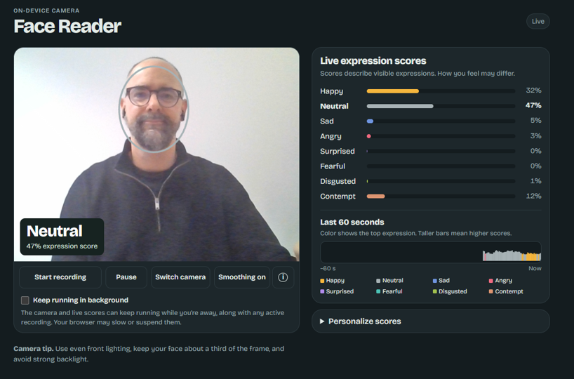

Recently, I ran a small, fun “experiment” with my own facial expressions during a week of meetings.

As a private side project, I built a little app for that. It shows live scores for eight basic facial expressions. You can fine-tune it for your own face and camera placement by teaching it what you look like when you’re relaxed and giving it examples of other expressions. You can also record the scores and export them with timestamps as a CSV. It all runs in your browser, so your video stays on your device. It only uses your own webcam, so it never sees the other people on your screen.

What did I find? Well, not much, which can actually be a good thing, as it means my face is apparently less of a giveaway than I feared 🤭

Still, I found a few things interesting. My “happy” faces tended to show up most often at the beginning and end of meetings 🙂 A lower camera made me look angry to the app even when I wasn’t 👺 And I can’t make a clean contempt face, however hard I try. Probably for the best 🙃

If you want to run your own small “experiment”, you can try the app for free [here](https://lstehlik2809.github.io/face-emotion-reader/){target="_blank"}.

⚠️ Just keep in mind that the scores are guesses about what your face looks like on camera. The same expression can go with very different feelings. Lighting and camera angle can change the scores. The model can mislabel subtle expressions, and smoothing can hide brief ones. Your browser can also slow or pause the recording if you leave it running in the background.

<strong>One more thing: this is a toy for self-curiosity only. Please don’t point it at colleagues, employees, or candidates. In the EU, that kind of use is prohibited, and rightly so.</strong>

Have fun!

